# Multi-layer anomaly detection: results

Generated by `run_all.py` from the files in `outputs/`. Every number below is measured on a test period that was never used for training, early stopping or threshold selection. Bracketed ranges are 95% bootstrap intervals over the test set.

## 1. Headline results

**Table: Ensemble performance on the positive class, per layer.**

| Layer | Test set | Positives | Precision [95% CI] | Recall [95% CI] | F1 [95% CI] | PR-AUC | ROC-AUC | MCC |
|---|---|---|---|---|---|---:|---:|---:|
| Layer 1: transactions (Elliptic++) | 16,670 labelled | 1,083 illicit | 0.961 [0.947, 0.973] | 0.729 [0.704, 0.758] | 0.829 [0.812, 0.850] | 0.806 | 0.942 | 0.828 |
| Layer 2: wallets (Elliptic++) | 92,451 labelled | 4,889 illicit | 0.974 [0.968, 0.980] | 0.533 [0.519, 0.547] | 0.689 [0.677, 0.701] | 0.722 | 0.938 | 0.711 |
| Layer 3: network traffic (UGR'16) | 7,345 labelled | 769 attack | 0.833 [0.804, 0.861] | 0.675 [0.637, 0.707] | 0.746 [0.718, 0.770] | 0.829 | 0.969 | 0.724 |

## 2. Experimental protocol

- **Temporal split.** Models are fitted on the earliest time steps, tuned on the last training steps (validation) and evaluated on later, unseen steps. No random shuffling.
- **Model.** Average of LightGBM, XGBoost and Random Forest, several seeds each. Boosting rounds come from early stopping on validation; models are then refitted on fit + validation.
- **Thresholds.** The decision threshold maximises validation F1. A lower review threshold keeps 95% validation recall. Scores between the two give the verdict *suspicious*.
- **Baselines.** Logistic regression, an unsupervised Isolation Forest fitted on the negative class only, and the default 50-tree Random Forest used in prior work. Baselines use the original features only.
- **Graph features (layers 1-2).** Degrees, 2-hop reach, component size, and the mean feature vector of in- and out-neighbours. Features are propagated, labels never are.

**Table: Layer 1: transactions (Elliptic++) - temporal data split.**

| split | time steps | labelled | illicit | licit | illicit % | unlabelled |
|---|---|---:|---:|---:|---:|---:|
| fit | 1-29 | 26,381 | 2,871 | 23,510 | 10.9 | 94,423 |
| validation | 30-34 | 3,513 | 591 | 2,922 | 16.8 | 11,948 |
| train (fit+val) | 1-34 | 29,894 | 3,462 | 26,432 | 11.6 | 106,371 |
| test | 35-49 | 16,670 | 1,083 | 15,587 | 6.5 | 50,834 |

**Table: Layer 2: wallets (Elliptic++) - temporal data split.**

| split | time steps | labelled | illicit | licit | illicit % | unlabelled |
|---|---|---:|---:|---:|---:|---:|
| fit | 1-29 | 152,613 | 7,624 | 144,989 | 5.0 | 321,507 |
| validation | 30-34 | 20,290 | 1,753 | 18,537 | 8.6 | 36,430 |
| train (fit+val) | 1-34 | 172,903 | 9,377 | 163,526 | 5.4 | 357,937 |
| test | 35-49 | 92,451 | 4,889 | 87,562 | 5.3 | 199,651 |

**Table: Layer 3: network traffic (UGR'16) - temporal data split.**

| split | days | labelled | attack | benign | attack % | unlabelled |
|---|---|---:|---:|---:|---:|---:|
| fit | 1-3 | 34,526 | 3,745 | 30,781 | 10.8 | 7,590 |
| validation | 4-4 | 11,659 | 872 | 10,787 | 7.5 | 2,459 |
| train (fit+val) | 1-4 | 46,185 | 4,617 | 41,568 | 10.0 | 10,049 |
| test | 5-5 | 7,345 | 769 | 6,576 | 10.5 | 1,215 |

## 3. Model comparison per layer

**Table: Layer 1: transactions (Elliptic++) - all models on the test period.**

| Model | Role | Features | Precision | Recall | F1 | F1 seed std | FPR | MCC | PR-AUC | ROC-AUC | Micro-F1 |
|---|---|---|---:|---:|---:|---:|---:|---:|---:|---:|---:|
| Logistic Regression | baseline | original | 0.893 | 0.519 | 0.657 | -- | 0.004 | 0.666 | 0.718 | 0.894 | 0.965 |
| Isolation Forest (unsupervised) | baseline | original | 0.064 | 0.989 | 0.121 | -- | 1.000 | -0.086 | 0.036 | 0.168 | 0.064 |
| Random Forest (50 trees, default) | baseline | original | 0.964 | 0.720 | 0.825 | -- | 0.002 | 0.824 | 0.785 | 0.913 | 0.980 |
| LightGBM | member | all | 0.952 | 0.731 | 0.827 | 0.000 | 0.003 | 0.825 | 0.808 | 0.938 | 0.980 |
| XGBoost | member | all | 0.896 | 0.736 | 0.808 | 0.006 | 0.006 | 0.800 | 0.814 | 0.944 | 0.977 |
| Random Forest | member | all | 0.949 | 0.718 | 0.818 | 0.005 | 0.003 | 0.816 | 0.800 | 0.941 | 0.979 |
| Ensemble (ours) | ensemble | all | 0.961 | 0.729 | 0.829 | -- | 0.002 | 0.828 | 0.806 | 0.942 | 0.981 |

**Table: Layer 1: transactions (Elliptic++) - ensemble metrics with 95% bootstrap intervals.**

| Metric | Estimate | CI 2.5% | CI 97.5% |
|---|---:|---:|---:|
| precision | 0.961 | 0.947 | 0.973 |
| recall | 0.729 | 0.704 | 0.758 |
| f1 | 0.829 | 0.812 | 0.850 |
| fpr | 0.002 | 0.001 | 0.003 |
| mcc | 0.828 | 0.811 | 0.848 |
| pr_auc | 0.806 | 0.783 | 0.827 |
| roc_auc | 0.942 | 0.934 | 0.948 |

**Table: Layer 2: wallets (Elliptic++) - all models on the test period.**

| Model | Role | Features | Precision | Recall | F1 | F1 seed std | FPR | MCC | PR-AUC | ROC-AUC | Micro-F1 |
|---|---|---|---:|---:|---:|---:|---:|---:|---:|---:|---:|
| Logistic Regression | baseline | original | 0.338 | 0.497 | 0.403 | -- | 0.054 | 0.370 | 0.263 | 0.811 | 0.922 |
| Isolation Forest (unsupervised) | baseline | original | 0.055 | 0.948 | 0.104 | -- | 0.908 | 0.032 | 0.061 | 0.552 | 0.137 |
| Random Forest (50 trees, default) | baseline | original | 0.405 | 0.193 | 0.262 | -- | 0.016 | 0.253 | 0.326 | 0.858 | 0.942 |
| LightGBM | member | all | 0.957 | 0.560 | 0.707 | 0.003 | 0.001 | 0.722 | 0.721 | 0.937 | 0.975 |
| XGBoost | member | all | 0.968 | 0.444 | 0.609 | 0.101 | 0.001 | 0.645 | 0.714 | 0.933 | 0.970 |
| Random Forest | member | all | 0.939 | 0.442 | 0.601 | -- | 0.002 | 0.633 | 0.703 | 0.934 | 0.969 |
| Ensemble (ours) | ensemble | all | 0.974 | 0.533 | 0.689 | -- | 0.001 | 0.711 | 0.722 | 0.938 | 0.975 |

**Table: Layer 2: wallets (Elliptic++) - ensemble metrics with 95% bootstrap intervals.**

| Metric | Estimate | CI 2.5% | CI 97.5% |
|---|---:|---:|---:|
| precision | 0.974 | 0.968 | 0.980 |
| recall | 0.533 | 0.519 | 0.547 |
| f1 | 0.689 | 0.677 | 0.701 |
| fpr | 0.001 | 0.001 | 0.001 |
| mcc | 0.711 | 0.701 | 0.721 |
| pr_auc | 0.722 | 0.711 | 0.731 |
| roc_auc | 0.938 | 0.935 | 0.941 |

**Table: Layer 3: network traffic (UGR'16) - all models on the test period.**

| Model | Role | Features | Precision | Recall | F1 | F1 seed std | FPR | MCC | PR-AUC | ROC-AUC | Micro-F1 |
|---|---|---|---:|---:|---:|---:|---:|---:|---:|---:|---:|
| Logistic Regression | baseline | all | 0.613 | 0.662 | 0.637 | -- | 0.049 | 0.593 | 0.665 | 0.927 | 0.921 |
| Isolation Forest (unsupervised) | baseline | all | 0.431 | 0.303 | 0.356 | -- | 0.047 | 0.301 | 0.501 | 0.830 | 0.885 |
| Random Forest (50 trees, default) | baseline | all | 0.876 | 0.174 | 0.291 | -- | 0.003 | 0.367 | 0.856 | 0.968 | 0.911 |
| LightGBM | member | all | 0.865 | 0.666 | 0.752 | 0.051 | 0.012 | 0.735 | 0.864 | 0.974 | 0.954 |
| XGBoost | member | all | 0.895 | 0.590 | 0.712 | 0.001 | 0.008 | 0.703 | 0.843 | 0.965 | 0.950 |
| Random Forest | member | all | 0.762 | 0.616 | 0.682 | -- | 0.023 | 0.653 | 0.724 | 0.960 | 0.940 |
| Ensemble (ours) | ensemble | all | 0.833 | 0.675 | 0.746 | -- | 0.016 | 0.724 | 0.829 | 0.969 | 0.952 |

**Table: Layer 3: network traffic (UGR'16) - ensemble metrics with 95% bootstrap intervals.**

| Metric | Estimate | CI 2.5% | CI 97.5% |
|---|---:|---:|---:|
| precision | 0.833 | 0.804 | 0.861 |
| recall | 0.675 | 0.637 | 0.707 |
| f1 | 0.746 | 0.718 | 0.770 |
| fpr | 0.016 | 0.013 | 0.019 |
| mcc | 0.724 | 0.696 | 0.750 |
| pr_auc | 0.829 | 0.802 | 0.853 |
| roc_auc | 0.969 | 0.963 | 0.974 |

## 4. Comparison with published results

Published numbers are copied from Elmougy & Liu (KDD 2023, arXiv:2306.06108v1, Tables 7 and 8), who use the same split (steps 1-34 train, 35-49 test). The *reproduction* row is their strongest single model re-run inside this pipeline.

**Table: Layer 1: transactions (Elliptic++) - illicit-class results against prior work.**

| Source | Model | Precision | Recall | F1 |
|---|---|---:|---:|---:|
| Elmougy & Liu (2023), as published | Logistic Regression | 0.328 | 0.707 | 0.448 |
| Elmougy & Liu (2023), as published | Random Forest | 0.975 | 0.719 | 0.828 |
| Elmougy & Liu (2023), as published | MLP | 0.611 | 0.613 | 0.612 |
| Elmougy & Liu (2023), as published | LSTM | 0.709 | 0.223 | 0.339 |
| Elmougy & Liu (2023), as published | XGBoost | 0.793 | 0.718 | 0.754 |
| Elmougy & Liu (2023), as published | RF+MLP+XGB ensemble | 0.962 | 0.723 | 0.826 |
| Our reproduction (same split, original features, threshold 0.5) | Random Forest (50 trees, default) | 0.964 | 0.720 | 0.825 |
| This work | LightGBM | 0.952 | 0.731 | 0.827 |
| This work | XGBoost | 0.896 | 0.736 | 0.808 |
| This work | Random Forest | 0.949 | 0.718 | 0.818 |
| This work | Ensemble (ours) | 0.961 | 0.729 | 0.829 |

**Table: Layer 2: wallets (Elliptic++) - illicit-class results against prior work.**

| Source | Model | Precision | Recall | F1 |
|---|---|---:|---:|---:|
| Elmougy & Liu (2023), as published | Logistic Regression | 0.477 | 0.046 | 0.083 |
| Elmougy & Liu (2023), as published | Random Forest | 0.911 | 0.789 | 0.845 |
| Elmougy & Liu (2023), as published | MLP | 0.708 | 0.502 | 0.587 |
| Elmougy & Liu (2023), as published | LSTM | 0.922 | 0.033 | 0.064 |
| Elmougy & Liu (2023), as published | XGBoost | 0.869 | 0.534 | 0.662 |
| Elmougy & Liu (2023), as published | RF+MLP+XGB ensemble | 0.933 | 0.572 | 0.709 |
| Our reproduction (same split, original features, threshold 0.5) | Random Forest (50 trees, default) | 0.405 | 0.193 | 0.262 |
| This work | LightGBM | 0.957 | 0.560 | 0.707 |
| This work | XGBoost | 0.968 | 0.444 | 0.609 |
| This work | Random Forest | 0.939 | 0.442 | 0.601 |
| This work | Ensemble (ours) | 0.974 | 0.533 | 0.689 |

The published wallet Random Forest F1 (0.845) is not reproduced here (0.262 with the same model settings on a time-based split). The published paper does not state how wallets that appear in several time steps are assigned to train or test, so the two numbers may not measure the same task; treat the comparison as indicative.

**Table: Wallet layer - effect of the evaluation protocol.**

| Protocol | Precision | Recall | F1 | PR-AUC |
|---|---:|---:|---:|---:|
| first-seen (one row per wallet, leak-free) | 0.974 | 0.533 | 0.689 | 0.722 |
| row per wallet per time step | 0.926 | 0.569 | 0.705 | 0.719 |

## 5. Ablation: contribution of graph features

**Table: Ensemble with and without graph-derived features.**

| Layer | Features | # features | Precision | Recall | F1 | PR-AUC | ROC-AUC |
|---|---|---:|---:|---:|---:|---:|---:|
| transaction | Original features only | 182 | 0.900 | 0.733 | 0.808 | 0.800 | 0.934 |
| transaction | + graph features (full model) | 555 | 0.961 | 0.729 | 0.829 | 0.806 | 0.942 |
| transaction | Change from graph features | 373 | 0.061 | -0.004 | 0.021 | 0.005 | 0.008 |
| wallet | Original features only | 55 | 0.582 | 0.294 | 0.390 | 0.421 | 0.892 |
| wallet | + graph features (full model) | 174 | 0.974 | 0.533 | 0.689 | 0.722 | 0.938 |
| wallet | Change from graph features | 119 | 0.392 | 0.240 | 0.299 | 0.301 | 0.046 |

## 6. Robustness over time

**Table: Transaction layer - pooled results before and after the dark-market shutdown (time step 43).**

| Period | Illicit | Detected | False alarms | Precision | Recall | F1 |
|---|---:|---:|---:|---:|---:|---:|
| Steps 35-42 (before shutdown) | 914 | 787 | 14 | 0.983 | 0.861 | 0.918 |
| Steps 43-49 (after shutdown) | 169 | 3 | 18 | 0.143 | 0.018 | 0.032 |
| All test steps | 1,083 | 790 | 32 | 0.961 | 0.729 | 0.829 |

The model is trained on steps 1-34. Pooled F1 falls from 0.918 before the shutdown to 0.032 after it: the illicit transactions that remain behave differently from anything seen in training. This concept drift is the main limitation of a model that is trained once and not updated.

**Table: Layer 2: wallets (Elliptic++) - ensemble results per time step.**

| time_step | n_labelled | n_positive | n_flagged | tp | fp | fn | precision | recall | f1 |
|---:|---:|---:|---:|---:|---:|---:|---:|---:|---:|
| 35 | 5,172 | 429 | 375 | 374 | 1 | 55 | 0.997 | 0.872 | 0.930 |
| 36 | 8,755 | 589 | 595 | 583 | 12 | 6 | 0.980 | 0.990 | 0.985 |
| 37 | 3,268 | 429 | 343 | 329 | 14 | 100 | 0.959 | 0.767 | 0.852 |
| 38 | 3,376 | 183 | 95 | 94 | 1 | 89 | 0.989 | 0.514 | 0.676 |
| 39 | 3,646 | 127 | 55 | 55 | 0 | 72 | 1.000 | 0.433 | 0.604 |
| 40 | 8,257 | 442 | 172 | 167 | 5 | 275 | 0.971 | 0.378 | 0.544 |
| 41 | 5,642 | 172 | 83 | 83 | 0 | 89 | 1.000 | 0.483 | 0.651 |
| 42 | 9,188 | 399 | 156 | 146 | 10 | 253 | 0.936 | 0.366 | 0.526 |
| 43 | 5,928 | 97 | 4 | 0 | 4 | 97 | 0.000 | 0.000 | 0.000 |
| 44 | 7,877 | 279 | 195 | 189 | 6 | 90 | 0.969 | 0.677 | 0.797 |
| 45 | 8,871 | 27 | 10 | 0 | 10 | 27 | 0.000 | 0.000 | 0.000 |
| 46 | 4,335 | 508 | 422 | 422 | 0 | 86 | 1.000 | 0.831 | 0.908 |
| 47 | 6,724 | 196 | 1 | 0 | 1 | 196 | 0.000 | 0.000 | 0.000 |
| 48 | 7,089 | 381 | 4 | 2 | 2 | 379 | 0.500 | 0.005 | 0.010 |
| 49 | 4,323 | 631 | 165 | 162 | 3 | 469 | 0.982 | 0.257 | 0.407 |

**Table: Layer 3: network traffic (UGR'16) - ensemble results per day.**

| time_step | n_labelled | n_positive | n_flagged | tp | fp | fn | precision | recall | f1 |
|---:|---:|---:|---:|---:|---:|---:|---:|---:|---:|
| 5 | 7,345 | 769 | 623 | 519 | 104 | 250 | 0.833 | 0.675 | 0.746 |

## 7. Final verdicts

Every entity receives one of three verdicts. The full lists are in `outputs/<layer>/<layer>_verdicts.csv`.

**Table: Layer 1: transactions (Elliptic++) - verdicts on the test period by true label.**

| True label (test period) | licit | suspicious | illicit | total |
|---|---:|---:|---:|---:|
| illicit | 293 | 0 | 790 | 1,083 |
| licit | 15,555 | 0 | 32 | 15,587 |
| unlabelled | 46,998 | 0 | 3,836 | 50,834 |

**Table: Layer 2: wallets (Elliptic++) - verdicts on the test period by true label.**

| True label (test period) | licit | suspicious | illicit | total |
|---|---:|---:|---:|---:|
| illicit | 1,522 | 761 | 2,606 | 4,889 |
| licit | 82,946 | 4,547 | 69 | 87,562 |
| unlabelled | 158,326 | 35,674 | 5,651 | 199,651 |

**Table: Layer 3: network traffic (UGR'16) - verdicts on the test period by true label.**

| True label (test period) | benign | suspicious | attack | total |
|---|---:|---:|---:|---:|
| attack | 107 | 143 | 519 | 769 |
| benign | 6,225 | 247 | 104 | 6,576 |
| unlabelled | 1,058 | 97 | 60 | 1,215 |

## 8. Network layer details

**Table: Detection rate per attack type (test period).**

| attack_type | windows | detected | detection_rate | detected_or_suspicious_rate |
|---|---:|---:|---:|---:|
| nerisbotnet | 666 | 424 | 0.637 | 0.851 |
| dos | 72 | 72 | 1.000 | 1.000 |
| scan44 | 24 | 19 | 0.792 | 0.792 |
| scan11 | 7 | 4 | 0.571 | 0.571 |

**Table: Precision corrected for background down-sampling.**

| Quantity | Value |
|---|---:|
| background_rate | 0.0200 |
| precision_sampled | 0.8331 |
| precision_corrected | 0.0908 |
| recall | 0.6749 |
| f1_corrected | 0.1600 |
| fpr | 0.0158 |

## 9. Figures

### Layer 1: transactions (Elliptic++)

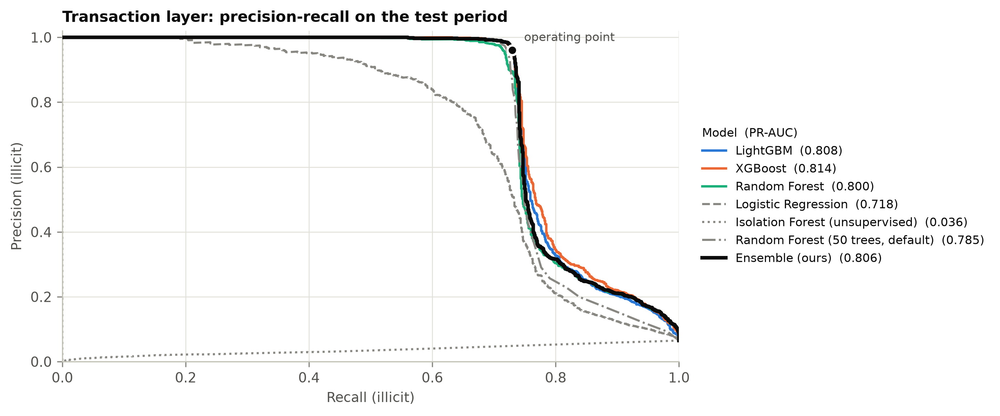

*Figure: Precision-recall curves, all models (transaction layer). Vector version: `figures/transaction/pr_curves.pdf`.*

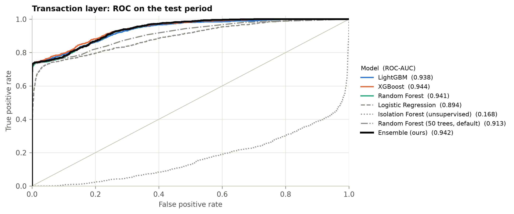

*Figure: ROC curves, all models (transaction layer). Vector version: `figures/transaction/roc_curves.pdf`.*

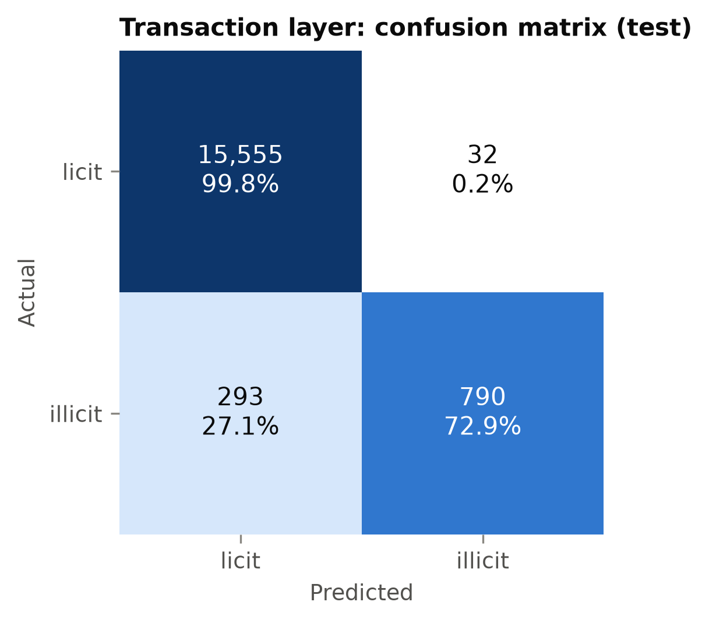

*Figure: Confusion matrix of the ensemble (transaction layer). Vector version: `figures/transaction/confusion_matrix.pdf`.*

*Figure: Performance over time (transaction layer). Vector version: `figures/transaction/per_time_step.pdf`.*

*Figure: Threshold sensitivity (transaction layer). Vector version: `figures/transaction/threshold_sweep.pdf`.*

*Figure: Score distribution by true class (transaction layer). Vector version: `figures/transaction/score_distribution.pdf`.*

*Figure: Reliability diagram (transaction layer). Vector version: `figures/transaction/calibration.pdf`.*

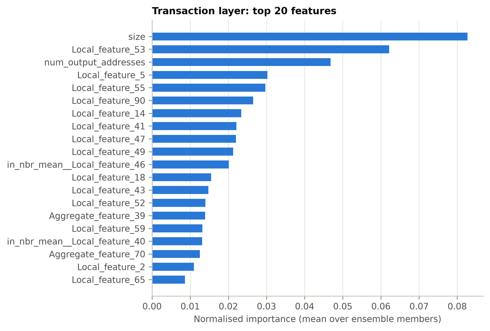

*Figure: Top features (transaction layer). Vector version: `figures/transaction/feature_importance.pdf`.*

### Layer 2: wallets (Elliptic++)

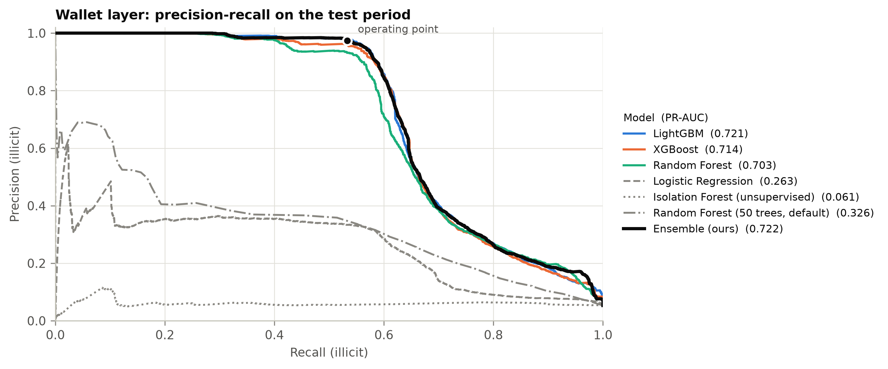

*Figure: Precision-recall curves, all models (wallet layer). Vector version: `figures/wallet/pr_curves.pdf`.*

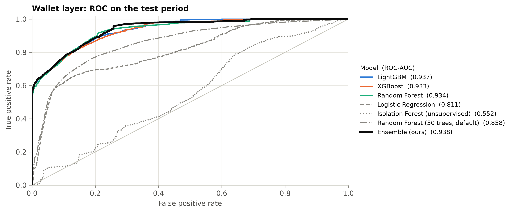

*Figure: ROC curves, all models (wallet layer). Vector version: `figures/wallet/roc_curves.pdf`.*

*Figure: Confusion matrix of the ensemble (wallet layer). Vector version: `figures/wallet/confusion_matrix.pdf`.*

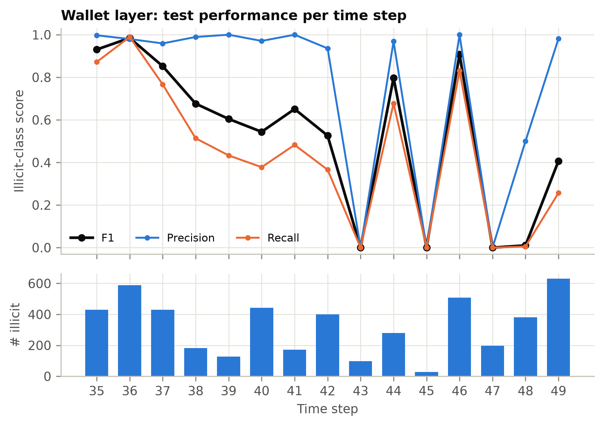

*Figure: Performance over time (wallet layer). Vector version: `figures/wallet/per_time_step.pdf`.*

*Figure: Threshold sensitivity (wallet layer). Vector version: `figures/wallet/threshold_sweep.pdf`.*

*Figure: Score distribution by true class (wallet layer). Vector version: `figures/wallet/score_distribution.pdf`.*

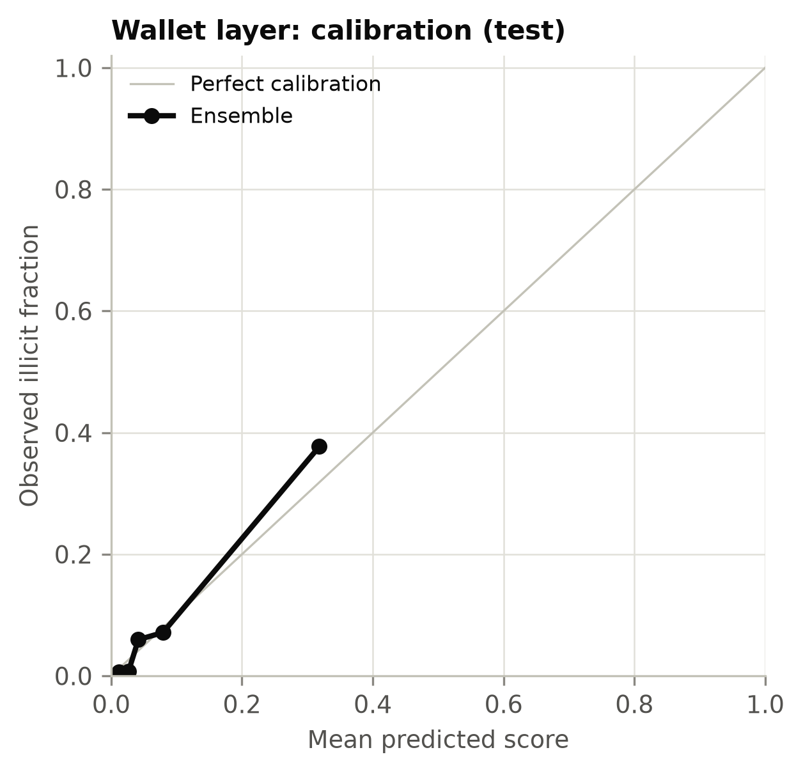

*Figure: Reliability diagram (wallet layer). Vector version: `figures/wallet/calibration.pdf`.*

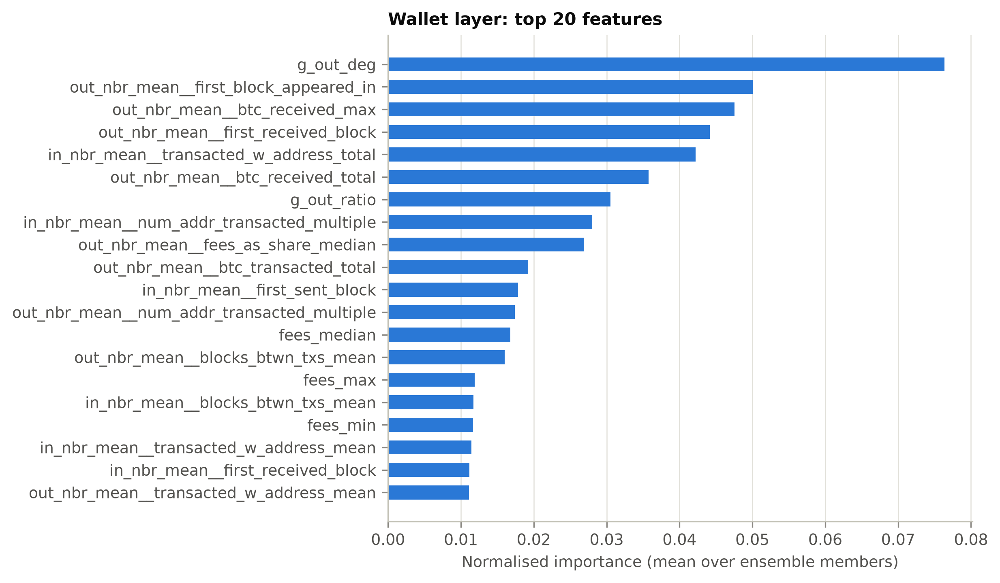

*Figure: Top features (wallet layer). Vector version: `figures/wallet/feature_importance.pdf`.*

### Layer 3: network traffic (UGR'16)

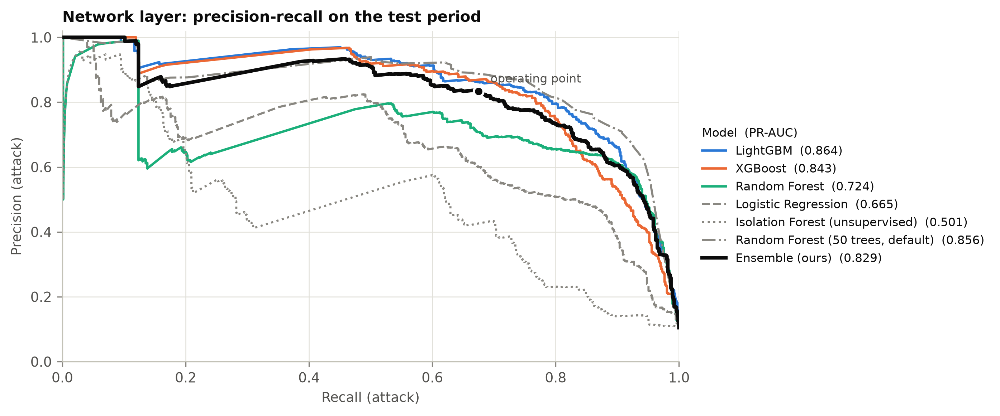

*Figure: Precision-recall curves, all models (network layer). Vector version: `figures/network/pr_curves.pdf`.*

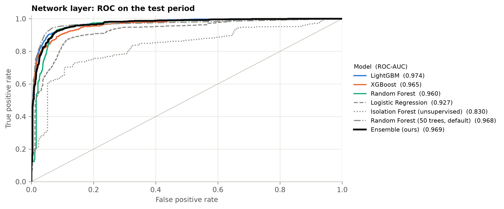

*Figure: ROC curves, all models (network layer). Vector version: `figures/network/roc_curves.pdf`.*

*Figure: Confusion matrix of the ensemble (network layer). Vector version: `figures/network/confusion_matrix.pdf`.*

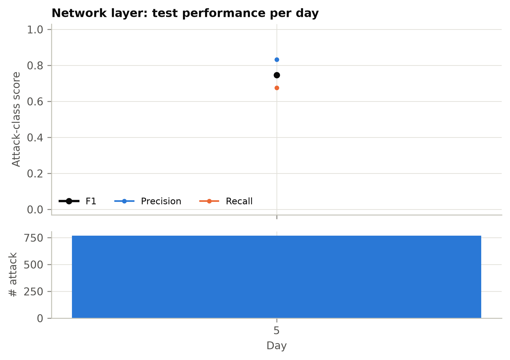

*Figure: Performance over time (network layer). Vector version: `figures/network/per_time_step.pdf`.*

*Figure: Threshold sensitivity (network layer). Vector version: `figures/network/threshold_sweep.pdf`.*

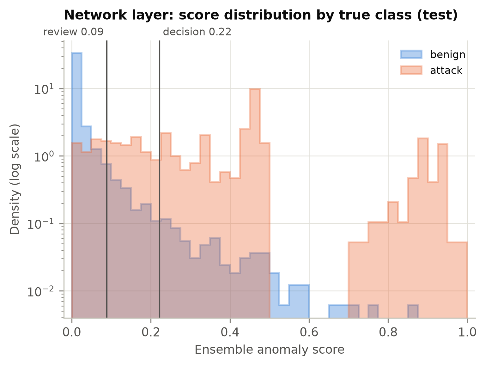

*Figure: Score distribution by true class (network layer). Vector version: `figures/network/score_distribution.pdf`.*

*Figure: Reliability diagram (network layer). Vector version: `figures/network/calibration.pdf`.*

*Figure: Top features (network layer). Vector version: `figures/network/feature_importance.pdf`.*

## 10. Limitations and threats to validity

- **Concept drift.** All layers are trained once and applied to the future. The transaction layer loses almost all recall after time step 43 (Section 6).
- **Label coverage.** Most Elliptic++ transactions and wallets are unlabelled. Metrics describe the labelled subset; verdicts on unlabelled entities cannot be verified.
- **Wallet features look ahead.** Elliptic++ computes each wallet's features over its whole lifetime, so a wallet's row contains information from after its first appearance.
- **Threshold transfer.** Thresholds are fixed on validation steps and can be mis-calibrated for later periods (see the threshold-sensitivity and calibration figures).
- **Layers are not fused.** Elliptic++ and UGR'16 share no entities or timestamps, so the network layer is an independent detector evaluated on a proxy dataset, not on Bitcoin network traffic.
- **Network sampling.** Background windows are down-sampled; recall and false-positive rate are unaffected, precision is reported both raw and corrected.
- **Single split.** One temporal split per layer; intervals capture test-set sampling noise and seed variance, not variation across alternative splits.
